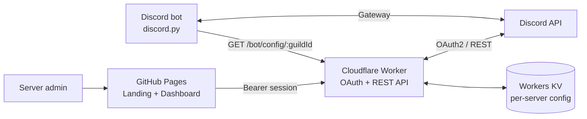

<div align="center">


<br>

**An Arabic-first Discord bot with its own web dashboard.**
Welcome messages, auto-replies, auto roles and moderation, configured from a clean control panel instead of commands.

<br>

[](https://opaidamazed.github.io/creatix-studio/)
[](https://discord.com/oauth2/authorize?client_id=1567973220165095605&permissions=1099780156438&scope=bot%20applications.commands)
[](https://github.com/opaidamazed/creatix-studio/stargazers)


</div>

---

## Why Creatix

Most bots make you memorise commands to change a welcome message. Creatix moves that into a dashboard: sign in with Discord, pick your server, edit, see a live preview, save. It is built Arabic-first (full RTL layout, Arabic typography) and anyone who manages a server can use it, with no code.

> If this project is useful or you like the design, a ⭐ helps a lot and takes one click.

[](https://github.com/opaidamazed/creatix-studio)

## Highlights

| | |
|---|---|
| **Dashboard with Discord login** | OAuth2 sign-in. You only see servers where you have *Manage Server* and the bot is present. |
| **Live welcome preview** | Edit title, text, colour, image and footer and watch the message update as you type. |
| **Multi-server by design** | Every server has its own isolated configuration. Add the bot, sign in, customise. |
| **Arabic-first UI** | RTL layout, IBM Plex Sans Arabic, and logical CSS properties throughout. |
| **Zero-cost stack** | GitHub Pages + Cloudflare Workers/KV + a free bot host. No servers to maintain. |
| **No build tooling** | The website is plain HTML, CSS and JavaScript. Open the files and edit. |

## Architecture



Three small pieces, each doing one job:

1. **Website** (`index.html` + `creatix-enhancements.css`): static landing page and dashboard.
2. **API** (`worker/worker.js`): Discord OAuth2, permission checks, and config storage in Workers KV.
3. **Bot** (`bot/bot.py`): the discord.py process that talks to Discord and runs the commands.

### Repository layout

```text
creatix-studio/
├── index.html                  # Landing page + dashboard (single page, hash-routed)
├── creatix-enhancements.css    # Visual layer: tokens, motion, responsive rules
├── assets/
│   └── banner.svg              # README banner
├── worker/
│   └── worker.js               # Cloudflare Worker: OAuth, API, KV storage
├── bot/
│   ├── bot.py                  # discord.py bot (slash commands, events)
│   ├── requirements.txt
│   └── .env.example
└── README.md
```

## The website

**Single-page, routed.** `/` shows the landing page and `/dashboard` shows the control panel. Both live in one `index.html`, so it deploys to GitHub Pages as-is with no router and no bundler.

**Landing page:** hero with an animated grid, feature cards, a three-step onboarding flow, a dashboard showcase, an FAQ built on native `<details>` elements (no JavaScript), and a closing call to action.

**Dashboard:**

- Sidebar navigation with an overview and a module per feature.
- Server switcher populated from the guilds you manage.
- **Welcome:** on/off switch, channel picker, title, message body, colour, image URL, footer, live preview, and a tips panel listing the variables `{member}`, `{server}` and `{count}`.
- **Auto-replies:** add and remove keyword → response pairs.
- **Auto role:** pick the role new members receive.

**Design system (`creatix-enhancements.css`):** an override layer on top of the base styles, so presentation can change without touching markup or logic.

- Design tokens as CSS custom properties (a deep violet palette with a light lavender highlight).
- Frosted-glass sticky header using `backdrop-filter`.
- Hero grid that slowly "breathes", button sheen on hover, and entrance animations.
- Responsive breakpoints at 900, 760, 620 and 440 px.
- Honours `prefers-reduced-motion`.
- Visible `:focus-visible` outlines for keyboard users.

## The API (Cloudflare Worker)

| Method | Endpoint | Auth | Purpose |
|---|---|---|---|
| `GET` | `/login` | none | Starts Discord OAuth2 (sets a short-lived `state` cookie). |
| `GET` | `/callback` | state cookie | Exchanges the code, creates a session, redirects to the site with `#sid=…`. |
| `GET` | `/api/guilds` | Bearer session | Servers you manage that also have the bot. |
| `GET` | `/api/guilds/:id/meta` | Bearer session | Text channels and assignable roles for the server. |
| `GET` / `PUT` | `/api/guilds/:id/config` | Bearer session | Read and save the server configuration. |
| `GET` | `/bot/config/:id` | `BOT_API_SECRET` | Lets the bot fetch a server's configuration. |

### Security notes

- **OAuth `state` check** protects the login flow against CSRF.
- **Session token travels in the URL fragment** (`#sid=…`), which browsers never send to servers, then lives in `localStorage` and is sent as a `Bearer` header.
- **Authorisation is enforced on the server.** Every request re-checks, against Discord, that you own the server or hold *Manage Server* or *Administrator*, and that the bot is a member.
- **Input is sanitised on save:** field length limits, `#rrggbb` colours only, `https://` image URLs only, capped number of replies, and a request-size limit.
- **Output is escaped** in the dashboard before it is rendered.
- **CORS is locked** to the dashboard's origin.
- **Secrets never live in the repository.** They are stored as Cloudflare secrets and bot-host environment variables.

## The bot

Built with **discord.py 2.x** and slash commands. Requires the *Server Members* and *Message Content* privileged intents.

| Area | Commands / behaviour |
|---|---|
| **Moderation** | `/ban`, `/unban`, `/kick`, `/mute`, `/unmute`, `/clear`, `/warn`, `/warnings`, `/clearwarnings`. Actions check the moderator permission and Discord role hierarchy. |
| **Channel controls** | `/lock` and `/unlock` control sending messages for @everyone; `/slowmode` sets a channel rate limit from 0 to 21,600 seconds. |
| **Server logs** | `/setlogs` and `/disablelogs` choose or disable a log channel. Creatix records member joins, bans, unbans, and moderation actions. |
| **Welcome** | Greets new members with `[user]` (mention), `[userName]` (display name), `[memberCount]` (server member count), and `[server]` (server name). Legacy `{member}`, `{server}` and `{count}` placeholders remain supported. Configure with `/setwelcome`. |
| **Auto role** | Assigns a role on join. Set up with `/setautorole`; the bot checks that the selected role is below its own top role. |
| **Auto-replies** | Replies when a message contains a keyword. Manage with `/addreply`, `/delreply`, `/replies`. |
| **Server utilities** | `/ping`, `/serverinfo`, and `/userinfo`. |

### Command permissions

Slash-command visibility is configured with Discord default permissions, and the bot also checks permissions at runtime. The bot checks its own permissions and role hierarchy before carrying out moderation or channel actions.

- **Ban / unban / kick:** users need Ban Members / Kick Members; the bot needs the matching permission. `/unban` takes the banned user's Discord ID.
- **Timeout / warnings:** users need Moderate Members; the bot needs Moderate Members for timeouts.
- **Clear messages:** users and bot need Manage Messages.
- **Lock / unlock:** users need Manage Channels and Manage Roles; the bot needs Manage Roles to edit the channel permission overwrite.
- **Slowmode:** users and bot need Manage Channels.
- **Log setup:** users need Manage Server. In the selected log channel, the bot needs View Channel, Send Messages and Embed Links.
- **Welcome / replies / auto role:** the matching server-management permission is required; the bot needs Send Messages in the selected welcome channel and Manage Roles for auto role.

**Important:** the updated invite asks for the additional **Manage Channels** permission required by `/slowmode`. Existing servers must grant that permission to Creatix (re-invite with the updated link or adjust the bot role in Server Settings → Roles).

Warnings and the selected log-channel ID are saved per server in the bot's ignored `data.json` file. They are not currently edited from the web dashboard.

Moderation commands cannot target the server owner or members whose highest role is equal to or above the moderator's or bot's role, where a hierarchy check applies.

### Welcome placeholders and bot presence

The `/setwelcome` message accepts these placeholders:

| Placeholder | Replaced with |
|---|---|
| `[user]` | Member mention |
| `[userName]` | Member display name without a mention |
| `[memberCount]` | Current server member count |
| `[server]` | Server name |

Older saved messages using `{member}`, `{server}`, and `{count}` continue to work.

Set the bot's Discord presence in the bot host's environment variables (or `bot/.env`):

| Variable | Values | Default |
|---|---|---|
| `BOT_STATUS` | `online`, `idle`, `dnd`, `invisible` | `online` |
| `BOT_ACTIVITY_TYPE` | `playing`, `watching`, `listening`, `competing`, `none` | `watching` |
| `BOT_ACTIVITY_TEXT` | Any short activity text | `your community` |

The bot applies its configured status when it connects and reconnects. **Presence settings do not run the bot process:** the bot must be running continuously on an always-on host to remain online. If the process stops or the host sleeps, Discord will show the bot as offline regardless of these values. After changing environment variables, restart the bot process.

### Status and roadmap

The web dashboard stores welcome, auto-role and auto-reply settings in Cloudflare KV and exposes them through `/bot/config/:id`. The bot still has a separate local configuration file for its slash-command settings; syncing both sides into one source of truth remains a follow-up task.

- [x] Landing page and dashboard with Discord login
- [x] Per-server configuration API with permission checks
- [x] Moderation, welcome, auto-role and keyword replies
- [x] Warnings, channel controls and configurable moderation logs
- [ ] Bot reads settings from the dashboard API (single source of truth)
- [ ] Embed-style welcome messages and welcome image cards
- [ ] Leave messages and a level system
- [ ] Community events and games (future phase)

## Run your own

You need a Discord application ([Developer Portal](https://discord.com/developers/applications)) and free accounts on GitHub, Cloudflare and a bot host.

**1. Bot**

```bash
cd bot
cp env.example .env           # add DISCORD_BOT_TOKEN and optional presence settings
pip install -r requirements.txt
python bot.py
```

Enable **Server Members Intent** and **Message Content Intent** in the Developer Portal under *Bot*.

**2. API:** create a Worker, paste `worker/worker.js`, bind a KV namespace named `CFG`, then add:

| Name | Type | Value |
|---|---|---|
| `CLIENT_ID` | Secret | Your application ID |
| `CLIENT_SECRET` | Secret | OAuth2 client secret |
| `BOT_TOKEN` | Secret | Bot token (used to list channels and roles) |
| `BOT_API_SECRET` | Secret | Any long random string |
| `FRONT` | Variable | URL of your site, e.g. `https://you.github.io/creatix-studio/` |

Add `https://<your-worker>.workers.dev/callback` under **OAuth2 → Redirects**.

**3. Website:** edit the `API` constant near the bottom of `index.html` to your Worker URL, push to GitHub, and enable **Settings → Pages**.

> Never commit `.env` or tokens. If a token is ever exposed, reset it in the Developer Portal immediately.

## Contributing

Issues and pull requests are welcome, especially for new dashboard modules, translations, and accessibility improvements.

## Credits

Designed and built by **Opaida**, graphic designer and web developer.
[GitHub](https://github.com/opaidamazed) · [Behance](https://www.behance.net/DESIGNEROPAIDA1)

<div align="center">

If Creatix saved you time, consider giving it a star.

[](https://github.com/opaidamazed/creatix-studio/stargazers)

</div>

---

<div dir="rtl" align="right">

## نبذة بالعربي

**Creatix Bot** بوت ديسكورد عربي بلوحة تحكم على الويب. تسجّل دخول بحساب Discord، تختار السيرفر، وتضبط رسالة الترحيب والردود التلقائية والرتبة التلقائية مع معاينة مباشرة، من غير أي كود.

- **متغيرات الترحيب:** `[user]` لمنشن العضو، `[userName]` لاسمه بدون منشن، `[memberCount]` لعدد الأعضاء، و`[server]` لاسم السيرفر. الصيغ القديمة تظل مدعومة.
- **حالة البوت:** تقدر تضبط `BOT_STATUS=online` وحالة النشاط من متغيرات البيئة. لازم عملية البوت تفضل شغالة على استضافة مستمرة عشان يفضل ظاهر Online.
- **لوحة تحكم متعددة السيرفرات:** كل سيرفر له إعداداته المستقلة، ولا تظهر لك إلا السيرفرات اللي عندك فيها صلاحية Manage Server.
- **واجهة عربية بالكامل:** تخطيط RTL وخط IBM Plex Sans Arabic.
- **أوامر إشراف:** حظر وطرد وميوت ومسح رسائل وتحذيرات وسجلات وتحكم في القنوات.
- **تكلفة صفر:** GitHub Pages مع Cloudflare Workers واستضافة بوت مجانية.

لو المشروع عجبك، نجمة ⭐ بتفرق معانا كتير.

</div>
